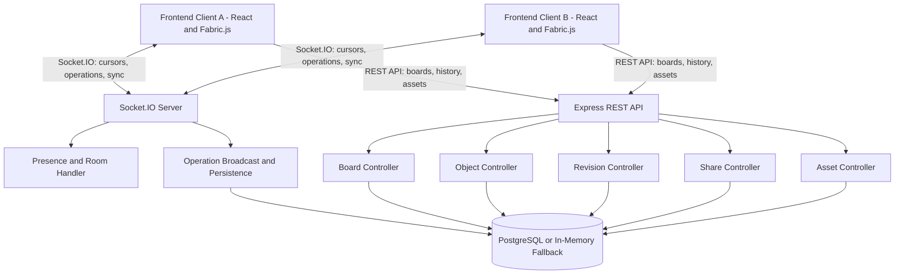

# PixelForge — The Shared Sanctum

**PixelForge** is a collaborative infinite-canvas workspace for visual brainstorming, note-taking, and team collaboration. This repository combines the React/TypeScript frontend with a Node.js/Express backend, real-time collaboration through Socket.IO, and PostgreSQL-backed persistence with an in-memory fallback.

> **Integration status:** This README consolidates the supplied frontend and backend documentation. Confirm all commands, routes, adapters, and service-dependent features against the integrated repository before treating them as production-ready. Mock adapters or the in-memory database fallback may be used when live services are not configured.

## Table of Contents

- [Features](#features)
- [Technology Stack](#technology-stack)
- [System Architecture](#system-architecture)
- [Repository Structure](#repository-structure)
- [Prerequisites](#prerequisites)
- [Getting Started](#getting-started)
- [Environment Configuration](#environment-configuration)
- [Database Setup](#database-setup)
- [Running the Application](#running-the-application)
- [Real-Time Collaboration Protocol](#real-time-collaboration-protocol)
- [REST API Reference](#rest-api-reference)
- [Testing and Validation](#testing-and-validation)
- [Known Limitations](#known-limitations)
- [Development Guidelines](#development-guidelines)
- [Contributors](#contributors)
- [License](#license)

## Features

### Frontend and Workspace UI
- Main workspace layout, header, controls, panels, and modals.
- Canvas coordinate indicator and canvas mounting integration point.
- Drawing and styling UI for brushes, eraser, highlighter, shapes, fill, and stroke controls where supported by the canvas adapter.
- Text formatting popover and toolbar.
- Reusable sticky-note templates.
- Live cursor overlay and collaboration UI.
- React hook for supported keyboard shortcuts.
- Board API service and adapter interfaces.
- Mock canvas/collaboration adapters and demo data for UI development.

### Backend and Collaboration
- Multi-user board rooms identified by `boardId`.
- Real-time cursor broadcasting through Socket.IO.
- Canvas operations for creating, updating, deleting, moving, resizing, and reordering objects.
- Active collaborator presence synchronization.
- REST APIs for board management, canvas objects, revisions, share links, and media assets.
- Revision snapshots and snapshot restore endpoints.
- PostgreSQL persistence with an in-memory fallback when PostgreSQL is unavailable or not configured.

## Technology Stack

- **Frontend:** React, TypeScript, Vite, Tailwind CSS/CSS, Lucide React, Fabric.js.
- **Backend:** Node.js, Express.
- **Real-time communication:** Socket.IO.
- **Database:** PostgreSQL 14+ (optional if using the in-memory fallback).
- **Integration:** REST APIs and Socket.IO events.

## System Architecture



## Repository Structure

The supplied frontend documentation describes the following frontend layout. The exact structure may differ in the integrated branch.

```text
src/
├── App.tsx
├── main.tsx
├── index.css
├── engine.css
├── adapters/
│   ├── mockCanvasAdapter.ts
│   └── mockCollabAdapter.ts
├── components/
│   ├── canvas/
│   ├── common/
│   ├── controls/
│   ├── entry/
│   ├── header/
│   ├── modals/
│   ├── presence/
│   └── toolbar/
├── context/
│   └── WorkspaceContext.tsx
├── engine/
│   ├── canvasCoordinates.ts
│   ├── chartRenderer.ts
│   ├── fabricCanvasAdapter.ts
│   ├── shapeDefinitions.ts
│   └── stickyNoteTemplates.ts
├── hooks/
│   └── useKeyboardShortcuts.ts
├── mocks/
│   └── demoData.ts
├── services/
│   └── boardApi.ts
└── types/
    ├── contracts.ts
    └── whiteboard.ts

public/
├── brand-mark.jpg
├── brand-mark.png
├── favicon.svg
└── sticky-notes/
```

The backend is documented as residing in `backend/`, with a PostgreSQL schema/migration script. Refer to the repository's current files for the exact backend structure.

## Prerequisites

- Node.js 18 or newer (Node.js LTS recommended).
- npm.
- Git.
- PostgreSQL 14 or newer, if using database persistence rather than the in-memory fallback.

## Getting Started

### 1. Install dependencies

Install dependencies from each package directory that has its own `package.json`.

```bash
# Backend
cd backend
npm install
```

Install frontend dependencies from the frontend package directory as well:

```bash
cd <frontend-directory>
npm install
```

Replace `<frontend-directory>` with the actual frontend directory in the integrated repository.

### 2. Configure environment variables

In the backend directory, copy `.env.example` to `.env` if that example file exists, then configure the values shown below. Do not commit `.env` or put secrets in frontend source code.

```env
PORT=5000
NODE_ENV=development
CLIENT_URL=http://localhost:5173

# PostgreSQL connection
PGHOST=localhost
PGPORT=5432
PGUSER=postgres
PGPASSWORD=replace_with_your_local_password
PGDATABASE=pixelforge
```

These are the backend variables documented in the supplied backend README. Confirm that the current implementation uses these exact names.

### 3. Initialize the database

If PostgreSQL is configured, run the database initialization script from the backend directory:

```bash
npm run db:init
```

This is documented as the automated schema runner for tables, indexes, and triggers. If you choose the in-memory fallback, database initialization may not be required.

### 4. Run the backend

From the backend directory:

```bash
# Development mode
npm run dev

# Production start
npm start
```

The backend is documented to run at `http://localhost:5000`. Health check:

```text
GET http://localhost:5000/api/health
```

### 5. Run the frontend

From the frontend package directory, run:

```bash
npm run dev
```

Vite commonly serves the frontend at `http://localhost:5173`; use the URL printed in your terminal if it differs.

### 6. Build and preview the frontend

Run these commands from the frontend package directory:

```bash
npm run build
npm run preview
```

> **Package configuration note:** The supplied frontend README warns that the integrated root `package.json` may be backend-oriented and may not contain frontend scripts or dependencies. Run commands from the appropriate package directory, or consolidate the package configuration carefully while preserving backend scripts.

## Environment Configuration

| Variable | Purpose | Documented example |
|---|---|---|
| `PORT` | Backend port | `5000` |
| `NODE_ENV` | Runtime environment | `development` |
| `CLIENT_URL` | Frontend origin allowed by the backend | `http://localhost:5173` |
| `PGHOST` | PostgreSQL host | `localhost` |
| `PGPORT` | PostgreSQL port | `5432` |
| `PGUSER` | PostgreSQL username | `postgres` |
| `PGPASSWORD` | PostgreSQL password | Set locally; do not commit |
| `PGDATABASE` | Database name | `pixelforge` |

The frontend API base URL and environment variable names depend on the current implementation of `services/boardApi.ts` and the adapter contracts. Check the source before adding or changing frontend configuration.

## PostgreSQL Database Schema

PixelForge uses PostgreSQL to store collaborative canvas data, canvas objects, revision history, and collaboration updates. The schema described in the supplied database README is designed for flexible canvas content and room-based collaboration.

### Database Tables

| Table | Purpose |
|---|---|
| `canvas_rooms` | Stores each canvas room, its complete Fabric.js canvas JSON, optional Yjs state, and timestamps. |
| `canvas_objects` | Optionally stores individual canvas objects and properties for object-level querying. |
| `canvas_revisions` | Stores numbered canvas snapshots for history and restoration. |
| `canvas_yjs_updates` | Stores encoded Yjs collaboration updates in an append-only log. |
| `canvas_members` | Stores room membership, display names, and roles (`owner`, `editor`, or `viewer`). |

The schema also defines indexes for common lookups and triggers that update `updated_at` when a canvas room or canvas object changes.

### Database Technologies

- **PostgreSQL** for persistent storage.
- **`pgcrypto`** extension for UUID generation.
- **`JSONB`** for canvas data, object properties, and revision snapshots.
- **`BYTEA`** for encoded collaboration state and Yjs updates.
- **`TIMESTAMPTZ`** for timestamps.

### Table Details

#### `canvas_rooms`

One record per collaborative canvas.

- `id`: Automatically generated UUID primary key.
- `room_id`: Unique room identifier used by the application.
- `room_name`: Canvas name, defaulting to `Untitled Canvas`.
- `created_by`: Optional creator identifier.
- `canvas_data`: Complete Fabric.js canvas JSON, defaulting to an empty canvas.
- `yjs_state`: Optional encoded Yjs document state.
- `created_at`, `updated_at`: Creation and last-update timestamps.

#### `canvas_objects`

Optional object-level storage for querying individual canvas elements.

- `room_id`: Foreign key to `canvas_rooms`; dependent objects are deleted with the room.
- `object_id`: Object identifier, unique within a room.
- `object_type`: Type of canvas object.
- `properties`: JSONB data such as coordinates, dimensions, colors, points, and text.
- `created_by`, `updated_by`: Optional user identifiers.
- `created_at`, `updated_at`: Timestamps.

#### `canvas_revisions`

Stores canvas snapshots for history and restoration.

- `room_id`: Related canvas room.
- `revision_number`: Revision sequence number, unique within a room.
- `created_by`: Optional identifier of the person who created the revision.
- `revision_note`: Optional note describing the revision.
- `snapshot`: Complete canvas snapshot in JSONB format.
- `created_at`: Creation timestamp.

#### `canvas_yjs_updates`

Stores encoded Yjs updates for collaborative editing.

- `room_id`: Related canvas room.
- `update_data`: Encoded update bytes.
- `client_id`: Optional client identifier.
- `created_at`: Update timestamp.

The application/Yjs layer is responsible for merging updates; the database stores them.

#### `canvas_members`

Stores room membership and each user's role.

Supported roles are `owner`, `editor`, and `viewer`. The schema enforces one membership record per user per room. The backend must enforce authentication, authorization, membership, and permissions.

### Manual Database Setup

If setting up PostgreSQL manually, create the database (replace the example name if needed):

```sql
CREATE DATABASE pixelforge;
```

Connect to it:

```bash
psql -U <your_username> -d pixelforge
```

Run the schema file from the repository:

```bash
psql -U <your_username> -d pixelforge -f "PG Local.session.sql"
```

Alternatively, open the SQL file in pgAdmin or another PostgreSQL client connected to the `pixelforge` database and execute it.

The supplied SQL documentation says the script enables `pgcrypto` if needed, creates tables and indexes if they do not already exist, and creates the timestamp trigger function and triggers. `CREATE TABLE IF NOT EXISTS` is not a full migration system; use explicit migrations for schema changes.

### Example Database Queries

Create a canvas room:

```sql
INSERT INTO canvas_rooms (room_id, room_name, created_by)
VALUES ('room-001', 'My First Canvas', 'user-001')
RETURNING id, room_id, room_name, created_at;
```

Retrieve a canvas by room ID:

```sql
SELECT room_id, room_name, canvas_data, yjs_state, updated_at
FROM canvas_rooms
WHERE room_id = 'room-001';
```

Store a canvas object (replace `<canvas-room-uuid>` with the actual UUID returned when creating the room):

```sql
INSERT INTO canvas_objects (room_id, object_id, object_type, properties, created_by)
VALUES (
    '<canvas-room-uuid>',
    'object-001',
    'rectangle',
    '{"x": 100, "y": 80, "width": 200, "height": 120, "fill": "#3498db"}'::jsonb,
    'user-001'
);
```

Save a revision snapshot:

```sql
INSERT INTO canvas_revisions (
    room_id, revision_number, created_by, revision_note, snapshot
)
VALUES (
    '<canvas-room-uuid>',
    1,
    'user-001',
    'Initial snapshot',
    '{"objects": [], "version": "6"}'::jsonb
);
```

List revision history:

```sql
SELECT revision_number, created_by, revision_note, created_at
FROM canvas_revisions
WHERE room_id = '<canvas-room-uuid>'
ORDER BY created_at DESC;
```

Add a room member:

```sql
INSERT INTO canvas_members (room_id, user_id, display_name, role)
VALUES ('<canvas-room-uuid>', 'user-002', 'Collaborator', 'editor');
```

Find objects of a specific type:

```sql
SELECT object_id, properties, updated_at
FROM canvas_objects
WHERE room_id = '<canvas-room-uuid>'
  AND object_type = 'rectangle';
```

### Indexes and Data Integrity

The supplied schema documentation describes:

- A descending `updated_at` index on `canvas_rooms`.
- Room and room/type indexes on `canvas_objects`.
- A GIN index on `canvas_objects.properties` for JSONB queries.
- A room/recent-time index on `canvas_revisions`.
- A room/update-ID index on `canvas_yjs_updates`.
- Foreign keys with `ON DELETE CASCADE` for room-dependent records.
- Unique constraints for room IDs, object IDs within a room, revision numbers within a room, and user membership within a room.
- A role check constraint limiting roles to `owner`, `editor`, and `viewer`.

### Database Implementation Notes

- The schema provides storage structures; it does not implement HTTP APIs, authentication, authorization checks, or live synchronization by itself.
- The backend must validate membership and permissions before allowing users to read or modify room data.
- Yjs update merging and synchronization belong to the application/Yjs layer.
- The schema contains both full-canvas JSON storage (`canvas_rooms.canvas_data`) and optional per-object storage (`canvas_objects`). If both are used, the application must keep them synchronized.
- The documented timestamp triggers apply to `canvas_rooms` and `canvas_objects`, not revision, membership, or Yjs update records.
- Use parameterized queries rather than constructing SQL statements from untrusted input.

---

## Database Setup

The backend documentation describes PostgreSQL persistence using the `pixelforge` schema, with an in-memory fallback if PostgreSQL is unavailable.

1. Install and start PostgreSQL if persistent storage is required.
2. Create/configure the database specified by `PGDATABASE`.
3. Set the database credentials in the backend `.env`.
4. Run `npm run db:init` from the backend directory.
5. Start the backend and verify `GET /api/health`.
6. Restart and test data persistence to confirm the application is using PostgreSQL rather than only in-memory storage.

The supplied backend README references `database/PG Local.session.sql` and the `npm run db:init` script. Confirm the exact filenames and script behavior in the repository.

## Running the Application

For local development, run the backend and frontend in separate terminals:

**Terminal 1 — Backend**
```bash
cd backend
npm run dev
```

**Terminal 2 — Frontend**
```bash
cd <frontend-directory>
npm run dev
```

Then open the frontend URL printed by Vite. Verify that the frontend API endpoint points to the backend and that backend CORS settings permit the frontend origin.

## Real-Time Collaboration Protocol

The following events are documented in the supplied backend README.

### Client to Server

| Event | Payload | Purpose |
|---|---|---|
| `join-board` | `{ boardId, user: { name, color, id? } }` | Join a board room and receive active collaborators. |
| `cursor-move` | `{ boardId, cursor: { x, y } }` | Broadcast pointer coordinates in world units. |
| `user-update` | `{ boardId, name?, color? }` | Update the display name or cursor badge color. |
| `canvas-operation` | `{ boardId, operation: BoardOperationPayload }` | Broadcast a canvas mutation, such as create, update, delete, or reorder. |
| `sync-canvas` | `{ boardId, objects: CanvasObject[] }` | Synchronize the full canvas state. |
| `create-revision` | `{ boardId, kind, label, snapshot }` | Create a snapshot checkpoint. |
| `leave-board` | `{}` | Leave the current room. |

### Server to Client

| Event | Payload | Purpose |
|---|---|---|
| `collaborators-update` | `Collaborator[]` | Full list of active participants and cursor positions. |
| `user-joined` | `Collaborator` | Notify clients when a participant joins. |
| `user-left` | `{ collaboratorId }` | Notify clients when a participant leaves or disconnects. |
| `cursor-update` | `{ collaboratorId, name, color, cursor }` | Update a peer's cursor position. |
| `operation-broadcast` | `BoardOperationPayload` | Deliver a canvas mutation from another collaborator. |
| `canvas-synced` | `{ objects, timestamp }` | Confirm canvas state synchronization. |
| `revision-created` | `BoardRevision` | Notify clients that a new snapshot was created. |

Confirm event names and payload shapes against the current server and frontend adapters before relying on them in production.

## REST API Reference

The endpoints below are documented in the supplied backend README. Their availability and exact request/response formats should be verified against the integrated backend.

### Health
- `GET /api/health` — Health check.

### Boards
- `GET /api/boards` — List active boards.
- `POST /api/boards` — Create a board.
- `GET /api/boards/:id` — Get board details, canvas objects, and recent revisions.
- `PATCH /api/boards/:id` — Update board name or settings.
- `DELETE /api/boards/:id` — Archive a board.

### Canvas Objects
- `GET /api/boards/:boardId/objects` — Get all canvas objects for a board.
- `POST /api/boards/:boardId/objects` — Upsert a single canvas object.
- `POST /api/boards/:boardId/objects/sync` — Batch-upsert canvas objects.
- `DELETE /api/boards/:boardId/objects/:objectId` — Soft-delete an object.
- `DELETE /api/boards/:boardId/objects` — Clear all objects on a canvas.

### Revisions and Time Travel
- `GET /api/boards/:boardId/revisions` — List revision snapshots.
- `POST /api/boards/:boardId/revisions` — Create a manual or autosave snapshot.
- `GET /api/boards/:boardId/revisions/:revisionId` — Inspect a snapshot.
- `POST /api/boards/:boardId/revisions/:revisionId/restore` — Restore a board to a snapshot.

### Share Links
- `POST /api/boards/:id/share` — Generate a share-link token.
- `GET /api/share/:token` — Validate a share token and retrieve board metadata.

### Assets and Uploads
- `POST /api/boards/:id/assets/upload` — Upload an image asset using `multipart/form-data`.
- `GET /api/boards/:id/assets` — List uploaded media for a board.

## Testing and Validation

### Backend tests

From the backend directory:

```bash
npm test
```

The supplied backend README says this test suite checks:
1. REST API endpoints such as `/api/health`, `/api/boards`, and `/api/boards/:id/objects`.
2. Multiple concurrent Socket.IO clients joining the same room.
3. Live cursor-coordinate broadcasts between simulated users.
4. Mutation-operation broadcasting and persistence.

### Frontend checks

From the frontend package directory:

```bash
npx tsc --noEmit
npm run build
```

The supplied frontend README reports that a Vite production build previously completed with a warning about a large bundle chunk. Re-run the checks after integration and dependency changes.

### End-to-end verification checklist

- [ ] Frontend starts and loads successfully.
- [ ] Backend health endpoint responds.
- [ ] Frontend API base URL and backend CORS configuration are correct.
- [ ] Board creation and retrieval work through the UI.
- [ ] Canvas objects persist after a page refresh when PostgreSQL is configured.
- [ ] Two separate browser sessions can join the same board.
- [ ] Cursor positions and canvas operations appear across sessions.
- [ ] Revision creation and restore work as expected.
- [ ] Share links and asset uploads are tested.
- [ ] Mock adapters and the in-memory fallback are clearly distinguished from live services.

## Known Limitations

- The integrated root package configuration may require frontend dependencies and scripts.
- Mock adapters may simulate canvas or collaboration behavior when live services are not connected.
- PostgreSQL persistence depends on valid database configuration and successful initialization.
- Multi-user synchronization, offline recovery, and other service-dependent behavior require end-to-end validation.
- A successful frontend-only build does not verify backend behavior or full collaboration.
- Production deployment configuration must be verified for the actual hosting environment.

## Development Guidelines

- Keep UI components focused and reusable.
- Use shared TypeScript contracts when coordinating frontend, canvas-engine, and backend changes.
- Keep canvas-engine implementation separate from UI-shell changes where practical.
- Review shared files carefully before merging branches.
- Run TypeScript checks, a frontend production build, and backend tests after integration.
- Verify REST routes, request/response formats, and Socket.IO event payloads against the current implementation.
- Do not commit generated output, local environment files, database passwords, or other secrets.
- Treat values bundled into frontend code as public.

## Contributors

- **Frontend / UI:** Project team
- **Backend / Collaboration:** Project team

Update this section with final contributor names and profile links if required.

## License

Refer to the repository's `LICENSE` file, if present, for the applicable license terms.
